  

  

  <b>I engineer autonomous AI systems and full-stack software that measurably replace manual operations</b> — turning chaotic workflows into reliable, automated high-throughput pipelines.

 

  
  

  

---

## 🚀 Featured Engineering

<table>
<tr>
<td width="50%" valign="top">

### 🤖 Autonomous Multi-Agent Orchestrator

Production-grade agentic pipeline coordinating autonomous sub-agents with dynamic tool-calling, state persistence, and self-correcting error handling.

- ⚡ **Sub-2s response latency** with streaming token output
- 📉 **~65% reduction** in manual extraction & validation tasks
- 🛡️ Zero-loss human-in-the-loop fallback mechanism

`LangGraph` `FastAPI` `Python` `PostgreSQL`

<a href="https://github.com/AbhiGuru25"><b>View Repository →</b></a>

</td>
<td width="50%" valign="top">

### ⚡ Enterprise Workflow & CRM Engine

Integrated webhook pipeline bridging lead ingestion, LLM schema parsing, and automated pipeline enrichment.

- 🎯 **10,000+ data records processed** with automated validation
- ⏱️ **Near real-time lead qualification** under 1.5 seconds
- 📈 **Eliminated 4+ hours/day** of manual data entry

`Next.js` `TypeScript` `n8n` `Webhooks`

<a href="https://github.com/AbhiGuru25"><b>View Repository →</b></a>

</td>
</tr>
</table>

---

## 🧰 Toolbox

  

| Domain | Stack |
|---|---|
| **AI & Agentic Systems** | LangChain • LangGraph • Multi-Agent Loops • RAG • Prompt Engineering • OpenAI / Anthropic APIs |
| **Full-Stack Development** | Next.js (App Router) • React • TypeScript • Tailwind CSS • HTML5/CSS3 |
| **Backend & Automation** | Python • FastAPI • Node.js • n8n Workflows • Webhooks & REST APIs • ERP / CRM Integrations |
| **Databases & DevOps** | PostgreSQL • Supabase • Docker • Git & GitHub Actions • Vercel • AWS |

---

## 📬 Let's Talk

  
  
  

  Open to Full-Stack &amp; AI Engineering roles, internships, and contract opportunities — India or Remote.

